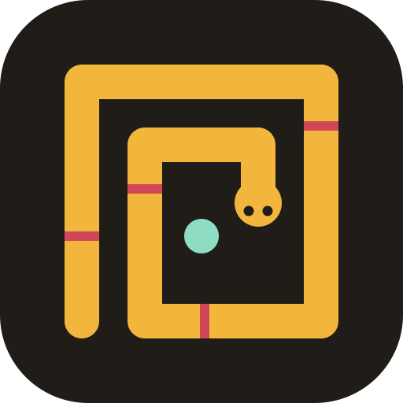
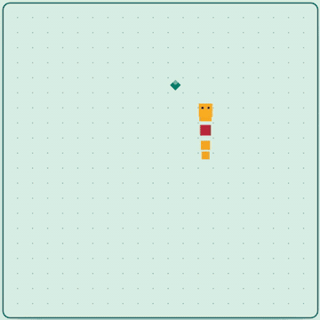

<p align="center">
  
</p>

<h1 align="center">Coil</h1>

<p align="center">
  Snake for phone, tablet and desktop browsers, with replays you can share as links and a leaderboard the client can't lie to.
</p>

<p align="center">
  <a href="https://github.com/AshwinSathian/coil/actions/workflows/ci.yml"></a>
  <a href="LICENSE"></a>
  
  
</p>

<p align="center">
  <a href="https://coil.ashwinsathian.com"><b>Play it at coil.ashwinsathian.com</b></a>
</p>

<p align="center">
  
  &nbsp;
  
</p>

## Features

- Five modes: Classic (solid walls), Gates (a run of generated rooms), Daily (one generated room per UTC day, with a leaderboard), Blitz (60 seconds, every edge wraps) and Zen (no game over; biting yourself cuts off your tail).
- Edges are set cell by cell. A solid stretch is a wall. A dashed stretch in the fruit colour is a gate: leave through it and you come back in on the opposite edge, same row or column. Gates and Daily mix both kinds and add walls inside the board.
- Two looks, switchable from the menu: Retro (block snake, Anybody wide type) and Modern (system type, a glowing tube, a board that warms as your multiplier climbs). Each has a light and a dark theme.
- Swipe, arrow keys/WASD/HJKL, or a gamepad. Up to three turns can be queued.
- Every game can be replayed and shared as a link.
- Installable, and playable offline after the first visit. A new version reloads in place only when you're on the menu, so it never interrupts a run.

## Controls

| | Touch | Keyboard | Gamepad |
|---|---|---|---|
| Turn | Swipe (one gesture can make several turns) | Arrows, WASD or HJKL | D-pad or left stick |
| Start, play again | Tap the button | Enter, Space or R | A |
| Pause | Pause button | P, or Space while playing | Start |
| Back to the menu | Menu button in the pause sheet | Esc | B |

## How it works

`src/sim.ts` is the whole game: an integer-only simulation with a seeded PRNG and no clock. The same seed and the same inputs always produce the same game. Several features rest on that:

1. **Replays as links.** A game is stored as its seed plus the ticks where the direction changed, varint-packed and base64url-encoded (`src/replay.ts`). A 55-segment Classic run is about 190 characters and fits in a URL fragment.
2. **Ghost runs.** In Daily, your best run of the day plays beside you as a faint snake.
3. **A leaderboard the client can't lie to.** The client sends inputs, never a score. The Worker (`worker/index.ts`) imports the same `sim.ts`, replays the run and stores the score it computes. A replay proves the run is legal. It does not prove a person played it live.
4. **Rooms.** Gates mode and Daily share one generator. It cuts each edge into mirrored runs of wall or gate and places mirrored inner walls, then keeps a wall only if a flood fill (which follows gates) still reaches every open cell. Each Gates room has fewer gates and more walls than the last.
5. **Old links keep working.** A replay's first byte is the rules revision it was played under. Daily rooms gained gates in revision 2. A revision-1 Daily link still rebuilds the old board, and the tests pin one replay per mode from before the change to its exact score.
6. **Title-screen demo.** An autopilot (`src/autopilot.ts`: shortest path to the fruit, taken only if the tail is still reachable afterwards) plays behind the menu. The tests also use it for fuzzing.

The renderer (`src/render.ts`) draws the frames between sim ticks. The head and tail slide, and the body is cell centres joined into one path. A snake that wraps around the board edge is drawn again, shifted by one board width.

Sound is synthesised with Web Audio, so the game ships no audio files. The build inlines all HTML, CSS and JS into one `index.html`, about 25 KB gzipped. The only other request is a 28 KB subset of the Anybody variable font.

## Getting started

Needs Node 24 or later (the tests run TypeScript directly).

```sh
git clone https://github.com/AshwinSathian/coil.git
cd coil
npm install
npm test                                   # sim, replay codec, autopilot fuzz
npx wrangler d1 migrations apply coil-db --local
npm run preview                            # build + wrangler dev with a local D1
```

`npm run dev` runs Vite alone, without the leaderboard API.

## Deploy

```sh
npx wrangler d1 migrations apply coil-db --remote
npm run deploy
```

Change `account_id`, the D1 `database_id` and `routes` in `wrangler.jsonc` to deploy to your own account. Cloudflare Workers serves the static files from the edge. Only `/api/*` runs Worker code, backed by D1 and a rate-limit binding (20 submissions per IP per minute).

## Project layout

| Path | What's in it |
|---|---|
| `src/sim.ts` | The whole game: integer-only, seeded, no clock |
| `src/replay.ts` | Replay codec, with a rules-revision byte |
| `src/autopilot.ts` | Title-screen player, also used for fuzzing |
| `src/render.ts` | Drawing between sim ticks, both looks |
| `src/audio.ts`, `src/input.ts`, `src/main.ts`, `src/store.ts`, `src/api.ts` | Sound, input, UI, local storage, leaderboard client |
| `src/sim.test.ts`, `src/fixtures-v1.json` | Tests, and pinned replays from the first rules revision |
| `worker/index.ts`, `migrations/` | Leaderboard Worker and its D1 schema |
| `scripts/demo-replay.ts` | Prints a replay link of an autopilot game |
| `public/` | Font, icons, manifest, service worker, cache headers |
| `docs/PLAN.md` | The plan the game was built from |

## Credits

Type: [Anybody](https://github.com/Etcetera-Type-Co/Anybody), SIL Open Font License (`public/fonts/OFL.txt`).

## License

Code: [MIT](LICENSE). Font: SIL Open Font License.
